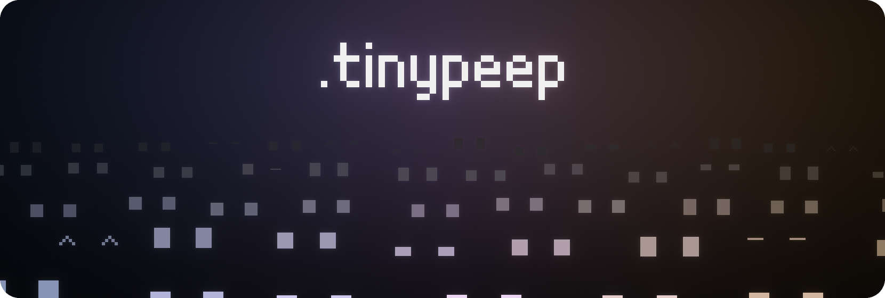
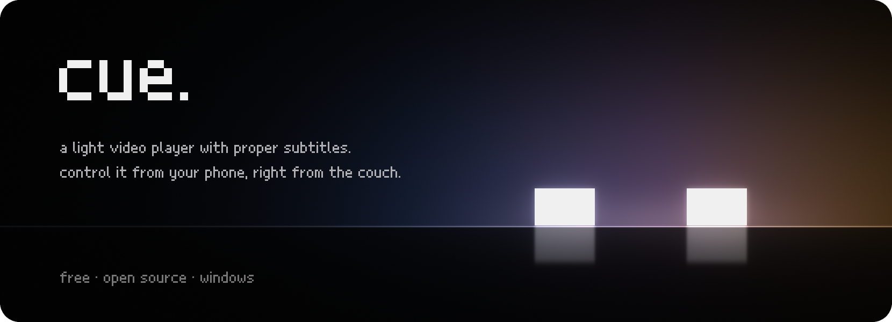
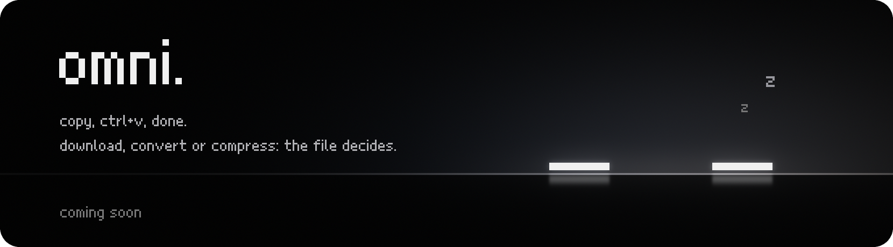
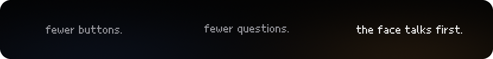

  

  <b>tiny, free apps for Windows.</b> 
  a pixel face instead of a cluttered interface.

 

  

  <a href="https://github.com/tinypeep/cue/releases/latest"><b>Download Cue</b></a>
  &nbsp;·&nbsp;
  <a href="https://github.com/tinypeep/cue">Source</a>
  &nbsp;·&nbsp;
  <a href="https://github.com/tinypeep/cue/issues">Report a bug</a>

 

  

 

  

 

  made in Brazil · <a href="https://github.com/tinypeep">github.com/tinypeep</a>

  help tiny, independent software keep going. ♡  
  

