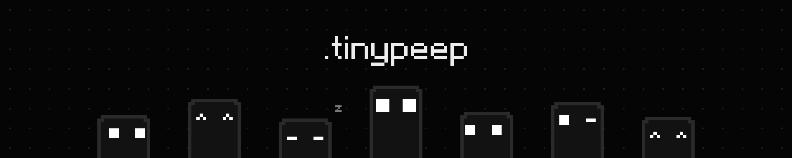
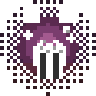

<p align="center">
  
</p>

<p align="center">
  tiny, free apps for Windows<br>
  <sub>a pixel face instead of a cluttered interface</sub>
</p>

<br>

<table>
  <tr>
    <td width="180" align="center"></td>
    <td>
      <h3><a href="https://github.com/tinypeep/cue">Cue</a></h3>
      a light video player with proper subtitles<br>
      control it from your phone, right from the couch<br>
      <sub>open source · free · Windows</sub>
    </td>
  </tr>
  <tr>
    <td width="180" align="center"></td>
    <td>
      <h3>Omni</h3>
      copy, ctrl+v, done<br>
      download, convert or compress: the file decides<br>
      <sub>coming soon</sub>
    </td>
  </tr>
</table>

<br>

```
fewer buttons
fewer questions
the face talks first
```

<p align="center"><sub>made in Brazil · <a href="https://github.com/tinypeep">github.com/tinypeep</a></sub></p>


<p align="center">
  <sub>help tiny, independent software keep going. ♡</sub><br><br>
  <a href="https://buymeacoffee.com/tinypeep"></a>
</p>
